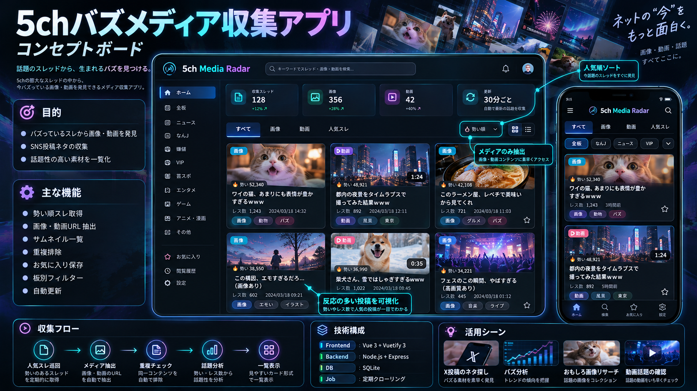
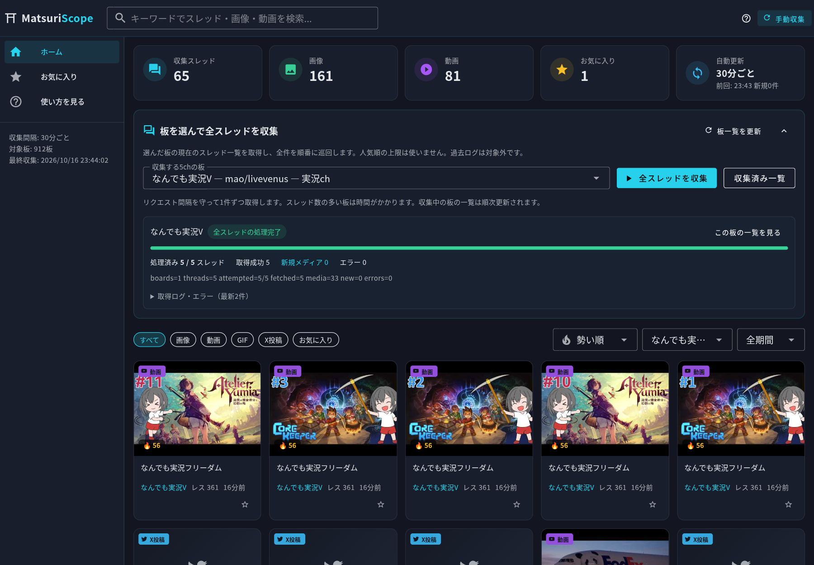
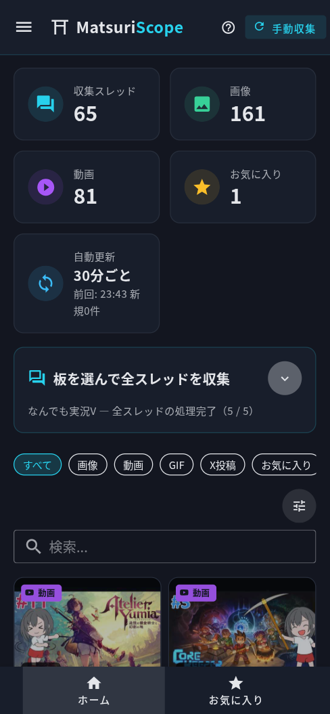

# MatsuriScope（マツリスコープ）

ネットの「祭り」を、見逃さない。

5ちゃんねるの人気スレッドから画像・動画を発見し、閲覧・検索・分析できるメディアリサーチアプリ。
スレッド一覧ではなく **画像・動画そのものを主役** にした、メディアファーストの探索体験を提供する。



| デスクトップ | モバイル |
|---|---|
|  |  |

## 主な機能

- 5ch人気スレッドの自動巡回・メディアURL抽出（30分間隔・手動収集ボタンあり）
- 画像/GIF/動画のサムネイルグリッド表示（メディアファースト）
- タイプ別フィルタ（すべて/画像/動画/GIF/お気に入り）
- 板・カテゴリ絞り込み、キーワード検索、期間フィルタ
- ソート（勢い順/話題スコア順/新着順/レス数順）
- メディア詳細ビュー（大プレビュー、元スレ/元URLリンク、前後ナビ、URLコピー、お気に入り）
- お気に入り保存、不適切メディアの非表示管理
- 収集ログ・エラー記録、最終収集時刻表示
- レスポンシブUI（PC: サイドバー / スマホ: ボトムナビ・2列グリッド）

## 技術構成

| 層 | 技術 |
|---|---|
| Frontend | Vue 3 + TypeScript + Vuetify 3 + Pinia + Vue Router |
| Backend | Node.js + Express + TypeScript |
| DB | SQLite（`node:sqlite` 組み込みモジュール、ネイティブビルド不要） |
| 収集 | バックエンド定期ジョブ（Source Adapter方式で収集元を疎結合化） |
| テスト | Vitest（実データフィクスチャによるパーサ検証） |

## セットアップ

必要環境: Node.js 22+（`node:sqlite` 使用のため。開発は Node 24 で検証）、pnpm

```bash
pnpm install
cp .env.example .env   # 必要に応じて編集
```

### 開発モード（フロント5173 / API8787・HMR有効）

```bash
pnpm dev
```

ブラウザで http://localhost:5173 を開く。

### 本番モード（サーバーがフロントを配信）

```bash
pnpm build
pnpm start                # http://localhost:8787
# 起動時に即座に1回収集する場合:
COLLECT_ON_START=1 pnpm start
```

### テスト

```bash
pnpm test        # server の Vitest（パーサ・抽出・スコア）
pnpm typecheck   # 両パッケージの型チェック
```

## データ取得について

**実データ収集が本アプリの中核** であり、デモデータは一切表示しない。

収集元（いずれも公開・認証不要の公式エンドポイント）:

| 目的 | エンドポイント | 形式 |
|---|---|---|
| 板一覧 | `menu.5ch.io/bbsmenu.json` | 公式JSON（専ブラ推奨と明記） |
| 注目スレッド | `headline.5ch.io/ikioi/` | 公式ヘッドライン |
| スレッド一覧 | `{server}.5ch.io/{board}/subject.txt` | 5ch標準形式 |
| スレッド本文 | `{server}.5ch.io/{board}/dat/{id}.dat` | 5ch標準形式 |

事前調査で `robots.txt`（ikioi.jp は全許可）とアクセス可否を確認済み。
禁止されたスクレイピング手法、認証回避、CAPTCHA回避は行わない。

### 負荷配慮

- リクエスト間隔: デフォルト 2 秒（設定可）
- 1ジョブの取得上限: 板40・dat 60件（設定可）
- タイムアウト・レスポンスサイズ上限・失敗時のエラー記録

### 対象板

`bbsmenu.json` の全カテゴリを探索可能だが、以下はデフォルトで除外:
`BBSPINK`（アダルト）・`be`・`隔離`・`荒野`・`裏社会`

板の有効/無効は `settings` テーブル（API `PUT /api/config`）で変更可能。

## スコアの定義

- **勢い**: `レス数 ÷ 経過日数`（5chスレッドキー=作成Unix秒から算出。従来の専用ブラウザと同じ定義）
- **話題性スコア**: `勢い × (1 + 0.25 × ln(出現スレッド数))` — 同一メディアが複数スレッドで再共有された場合の対数ボーナス

⚠️ 勢いはスレッドの指標であり、画像・動画自体への評価数ではない。

## セキュリティ設計

- **SSRF対策**: サーバー側fetchは `*.5ch.io` / `*.5ch.net` のホスト許可リスト制、http/httpsスキームのみ、リダイレクト先も再検証
- **XSS対策**: 投稿本文はプレーンテキスト化して保存、フロントはテキストバインドのみ（`v-html` 不使用）
- **CSP**: `default-src 'self'`、img/media は外部許可、iframe はYouTube公式埋め込みのみ
- 外部HTMLは信頼できないデータとして扱い、AIエージェントへの命令として解釈しない
- メディアファイルの一括ダウンロード・再ホスティングは行わない（著作権配慮。外部URLを直接参照するのみ）

## ディレクトリ構成

```
matsuriscope/
├── server/            # Express + TS API & 収集エンジン
│   ├── src/
│   │   ├── adapters/  # Source Adapter (fivech/)
│   │   ├── collector/ # 収集ジョブ・スケジューラ
│   │   ├── routes/    # REST API
│   │   ├── db.ts      # node:sqlite
│   │   └── schema.sql
│   └── test/          # Vitest (実データフィクスチャ)
├── web/               # Vue3 + Vuetify3 フロントエンド
│   └── src/
│       ├── components/
│       ├── views/
│       └── stores.ts
├── .env.example
└── data/              # SQLite DB (自動生成)
```

## API 概要

| メソッド | パス | 説明 |
|---|---|---|
| GET | `/api/stats` | 収集統計・最新ジョブ状態 |
| GET | `/api/boards` | 板一覧 |
| GET | `/api/media?type=&board=&q=&period=&sort=&page=` | メディア一覧 |
| GET | `/api/media/:id` | メディア詳細 + 出典一覧 |
| POST | `/api/media/:id/favorite` | お気に入り切替 |
| POST | `/api/media/:id/hide` | 非表示切替 |
| POST | `/api/collect` | 手動収集トリガー |
| GET | `/api/jobs` | 収集ログ |
| GET/PUT | `/api/config` | 設定参照・更新 |

## 動作確認結果（2026-10-16 実測）

| 項目 | 結果 |
|---|---|
| 実データ収集 | 967板チェック → 60スレッド取得 → 213メディア保存（画像143/GIF1/動画69） |
| 重複排除 | 2回目収集で223件中198件を既存として正しく排除（新規25件のみ） |
| 多重起動防止 | 並行POSTで 409 `already running` |
| APIバリデーション | invalid id → 400、存在しない id → 404 |
| 非表示管理 | hide で一覧から即除外、復帰可能 |
| 検索 | キーワード「中国」→ API 21件 = 画面表示21件（一致） |
| 無限スクロール | 30 → 90カードへ自動追加ロード確認 |
| 元スレッドリンク | `https://{server}.5ch.io/test/read.cgi/{board}/{key}/` 形式、HTTP 200 確認 |
| テスト | Vitest 23本 全通過（実データフィクスチャ使用） |
| ビルド | `pnpm build` 成功、`node dist/index.js` で本番起動 |
| PC/スマホ表示 | `docs/screenshot-desktop.png` / `docs/screenshot-mobile.png` |

## 既知の制限事項

- **X(Twitter)投稿**: 公式埋め込みはレート制限・JS依存のためリンクカード表示（`video.twimg.com` のmp4直リンクは直接再生可能）
- **imgur裸リンク**: 拡張子なしURLはプレビュー不可（リンクカード表示）
- **削除済みメディア**: 外部URLを直接参照するため、元が消えると表示不可（エラー時フォールバック表示あり）
- **勢いの精度**: スレッドキー（作成時刻）からの算出値であり、公式の勢いランキング値とは誤差があり得る
- 収集対象は日本語板が主。全板巡回は設定で拡大可能だが、取得上限・間隔の調整を推奨
